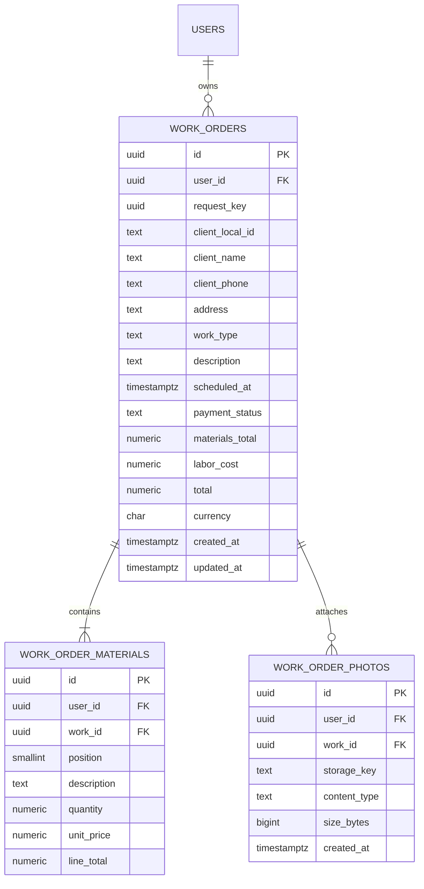

# Diseño backend: Nuevo Trabajo

## Alcance del formulario actual

`NewWorkScreen` captura un cliente seleccionado, domicilio del trabajo, tipo y descripción, fecha/hora, costo de mano de obra, una o más líneas de materiales, fotos y estado de pago inicial `Pendiente`. Los clientes y `tiposTrabajo` todavía se leen de AsyncStorage. Las fotos también viven en el sistema de archivos del teléfono.

La creación remota debe ser propiedad de la cuenta autenticada. El backend obtiene `user_id` de la sesión; nunca acepta un `user_id` enviado por la app.

## Modelo relacional



### Decisiones

- `work_orders` es el encabezado del trabajo. El cliente se guarda como una instantánea (`client_name`, `client_phone`, `client_local_id`): hoy la pantalla selecciona clientes locales y aún no existe una tabla remota de clientes. Así no bloqueamos esta etapa ni perdemos los datos visibles al crear el trabajo. Al migrar Clientes, `client_local_id` permitirá enlazar registros y pasar a una FK real.
- `work_order_materials` normaliza las líneas del formulario. Cantidades usan `NUMERIC(12,3)` y moneda `NUMERIC(12,2)`, evitando errores de coma flotante. `line_total` se calcula en PostgreSQL como `round(quantity * unit_price, 2)`.
- El servidor calcula `materials_total` y `total`; nunca confía en totales enviados por el móvil. La moneda queda explícita; la pantalla actual usa `$`, así que el valor inicial propuesto es `ARS`.
- `payment_status` acepta `Pendiente`, `Pagado` o `Cancelado`. Un trabajo cancelado no bloquea un nuevo horario.
- `request_key` permite reintentar un guardado móvil sin crear duplicados; es única por usuario cuando se proporciona.
- Las fotos no se guardan como URI `file://` ni dentro de PostgreSQL. Se suben como archivos a un volumen persistente de Docker; `work_order_photos` guarda solo sus metadatos y una clave opaca generada por el servidor.
- Todas las relaciones de materiales y fotos incluyen `user_id` en sus claves foráneas compuestas. Esto evita asociar por error un hijo al trabajo de otra cuenta.

## Restricciones e índices propuestos

- `work_orders`: FK a `users(id)`, `UNIQUE(user_id, id)`, `UNIQUE(user_id, request_key)`, campos obligatorios no vacíos, `labor_cost >= 0`, `materials_total >= 0`, `total = materials_total + labor_cost` y estado limitado a los tres valores anteriores.
- `work_order_materials`: FK `(user_id, work_id)` a `(user_id, id)` de `work_orders` con `ON DELETE CASCADE`; `quantity > 0`, `unit_price >= 0`, y `UNIQUE(work_id, position)`.
- `work_order_photos`: la misma FK compuesta, `size_bytes > 0`, MIME limitado a JPEG, PNG o WebP y `UNIQUE(storage_key)`.
- Índices: `(user_id, scheduled_at)`, `(user_id, payment_status, scheduled_at)`, y `(user_id, work_id, position)` para materiales. La PK de fotos/materiales cubre acceso por trabajo.

## API para la pantalla

Todas las rutas salvo health requieren `Authorization: Bearer <token>`.

| Método y ruta | Uso |
| --- | --- |
| `GET /api/v1/data/clientes` | Cargar clientes existentes durante la etapa de migración desde AsyncStorage. |
| `GET /api/v1/data/tiposTrabajo` | Cargar tipos de trabajo configurados por el usuario. |
| `POST /api/v1/works` | Crear encabezado y materiales en una transacción. |
| `GET /api/v1/works?from=...&to=...&payment_status=...` | Listar trabajos del usuario, con filtros de agenda. |
| `GET /api/v1/works/{id}` | Leer detalle, materiales y metadatos de fotos propios. |
| `PATCH /api/v1/works/{id}/payment-status` | Cambiar a `Pendiente`, `Pagado` o `Cancelado`. |
| `POST /api/v1/works/{id}/photos` | Subir una foto (`multipart/form-data`, campo `photo`). |
| `DELETE /api/v1/works/{id}/photos/{photoId}` | Eliminar una foto propia y su archivo. |

### Ejemplo de creación

```json
{
  "request_key": "9f3299bb-74a8-4dde-8d9b-429694fa595f",
  "client": {
    "local_id": "1730841200000",
    "name": "Ana Pérez",
    "phone": "+5491112345678"
  },
  "address": "San Martín 123",
  "work_type": "Instalación",
  "description": "Revisión del tablero",
  "scheduled_at": "2026-11-05T15:30:00-03:00",
  "labor_cost": "25000.00",
  "materials": [
    { "description": "Cable 2,5 mm", "quantity": "4.000", "unit_price": "1850.00" }
  ]
}
```

`POST /api/v1/works` responde `201` con el UUID del servidor, los subtotales, `total`, estado `Pendiente`, materiales y `photos: []`. La app adapta esa respuesta a los nombres que las pantallas existentes esperan (`clienteId`, `clienteNombre`, `tipoTrabajo`, `costoMateriales`, etc.).

## Validaciones del servidor

1. Requiere cliente, domicilio, tipo, descripción, fecha/hora y por lo menos un material.
2. Cada descripción de material debe tener texto; cantidad debe ser mayor que cero y precio/costo de mano de obra no pueden ser negativos.
3. La fecha debe incluir zona horaria. Se persiste como `timestamptz` y se devuelve en ISO 8601.
4. Antes de crear, busca otro trabajo del mismo usuario en el intervalo de un minuto alrededor del horario. Se serializa la reserva por usuario dentro de la transacción para evitar dos altas simultáneas en el mismo horario. Devuelve `409 schedule_conflict` si encuentra uno.
5. La inserción del trabajo y sus materiales es atómica: o se guardan todos, o ninguno.
6. Las fotos se validan por contenido y tamaño máximo; se generan nombres de archivo en el servidor y se impide que el cliente controle rutas.

## Implementación por pasos

1. Añadir migración SQL para trabajos, materiales e índices; crear `POST`, `GET` de lista/detalle y cambio de estado.
2. Añadir almacenamiento de fotos en volumen Docker y endpoints de subida/borrado.
3. Conectar `NewWorkScreen`: cargar clientes/tipos desde el API, enviar el trabajo remoto y adjuntar fotos. Conservar backup local hasta verificar migración de datos.

Este documento define el diseño; todavía no modifica la base de datos ni reemplaza el guardado local de la pantalla.
